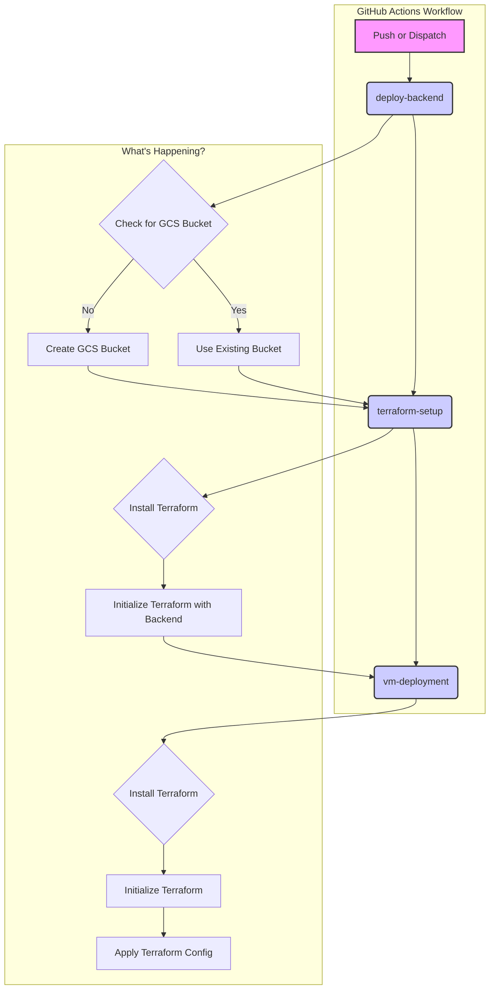

# Terraform GCP VM: Your Not-So-Ephemeral Cloud Companion (Unless You Want It To Be)

**Tired of your laptop sounding like a jet engine every time you run a VM? Want to feel like a real cloud wizard without the pointy hat?**

This project is your golden ticket to spinning up a Google Cloud VM with Terraform, faster than you can say "abracadabra." We're talking secure, configurable, and so easy to deploy, you'll wonder if it's actual magic. (Spoiler: it's just really good code).

## What's in the box?

*   **Zero Local Clutter:** Your Terraform state files live in a cozy GCS bucket, not on your machine. No more `terraform.tfstate` files littering your desktop!
*   **Fort Knox Security (Almost):** We use Google's fancy security features to keep your VM safe and sound.
*   **Deploy with a Wink and a Smile:** Our GitHub Actions workflow makes deployment a breeze. Just push your code and watch the magic happen.

## How the Magic Happens (The DevOps Workflow)

Behold, the mystical journey of your code from your fingertips to a running VM in the cloud!

## Ready to Become a Cloud Wizard?

1.  **Clone this repo.** (Go on, don't be shy.)
2.  **Follow the instructions.** (We promise they're not written in ancient runes.)
3.  **Lean back, sip your coffee, and let Terraform and GitHub Actions do the heavy lifting.**

## Got Questions, Ideas, or Memes?

We're all ears! Open an issue, send a pull request, or just share your favorite cloud-related meme.

**Happy Cloud Conjuring!**